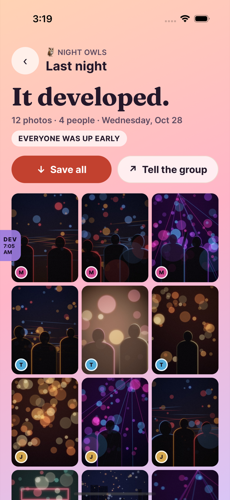

# NightCap

**The album from last night.** Friends snap into one shared roll while they're out. Nobody sees a
thing until the morning, when the album develops for everyone at once. It's BeReal for drunk
people: friends-only, and nothing posts by accident.



- **The night album:** start a night from your crew. Everyone gets a 24-shot roll. At 3am it says
  _Get some sleep_. In the morning you look through your own shots (toss anything), tap _I'm good_
  (it only counts after 7am), and once everyone's up the album develops: night turns to dawn.
- **Effortless sharing:** a 4-digit code you can say across the bar, a QR, or a link.
  Guests see only that night.
- **Old college friends:** long-distance crews, a weekly _Nightcap_ (one shot each, revealed when
  everyone's in), "one year ago tonight", month in review, gentle nudges and no streaks.
- **City Nights:** opt-in, ID-verified (stubbed), small tables at public bars, first names only, no
  DMs, keep in touch only on a mutual yes.
- **Drunk-proof and consent-first:** huge targets, hold-to-confirm, undo, anything permanent waits
  for the morning, GPS stripped from every photo, and anyone in a photo can hide it with one tap.

## Run it

```
make setup            # deps, .env with dev secrets, demo photos
make check            # typecheck, lint, format, every test suite, ledger, doctor
scripts/demo.sh start # API :8788 + Metro :8091 + our simulator + Expo Go
make maestro          # the core loop (and friends) driven end to end on the simulator
scripts/demo.sh stop
```

Mock mode needs no keys: Postgres runs in-process (PGlite) with the real migrations and RLS, and
media lives on local disk. See `docs/STATUS.md` for the demo script and what's needed for real.

## Where things are

`CLAUDE.md` (operating manual), `docs/WORKFLOW.md` (the loop), `docs/STATUS.md`, `docs/DIARY.md`,
`docs/IDEAS.md`, `docs/adr/`, `docs/research/`, `docs/reviews/`, `docs/media/` (screenshots + clip).
